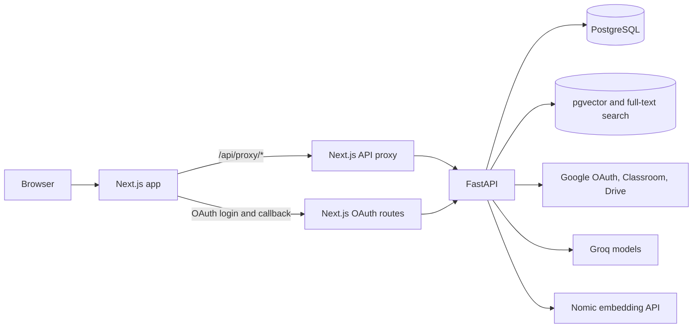
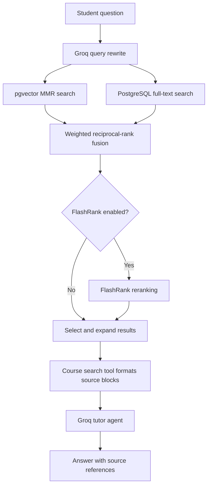

# OptiLearn

**An AI learning companion for your course materials.**

OptiLearn brings Google Classroom course files and personal study documents into one workspace. Index supported materials, ask questions in a conversational tutor, and explore answers with retrieval from your course content.

**Live Demo:** [opti-learn-ecru.vercel.app](https://opti-learn-ecru.vercel.app)  
**Built and developed by Nikky** · [GitHub profile](https://github.com/Nikky-SDE) · [Repository](https://github.com/Nikky-SDE/OptiLearn)

## Table of contents

- [Features](#features)
- [Technology stack](#technology-stack)
- [Architecture](#architecture)
- [Project structure](#project-structure)
- [AI tutor and retrieval](#ai-tutor-and-retrieval)
- [How OptiLearn works](#how-optilearn-works)
- [Installation and local setup](#installation-and-local-setup)
- [Environment variables](#environment-variables)
- [API documentation](#api-documentation)
- [Deployment](#deployment)
- [Roadmap](#roadmap)
- [Contributing](#contributing)
- [License](#license)
- [Author](#author)

## Features

- Sync courses from Google Classroom and retrieve supported course files from Google Drive.
- Upload PDF, DOCX, PPTX, TXT, Markdown, and image files to an existing course.
- Extract document text and image descriptions, then index them for semantic and full-text search.
- Ask a course-aware AI tutor questions in a chat interface, with persisted conversation sessions.
- Stream tutor output over Server-Sent Events (SSE).
- Generate topic summaries and flashcards from retrieved course material.
- Use optional Groq web search when explicitly requested in chat.

Courses are synced from Google Classroom; standalone local course creation and audio/video transcription are not currently supported.

## Technology stack

| Area | Technologies |
|---|---|
| Frontend | Next.js 16, React 19, TypeScript, Tailwind CSS v4, Radix UI |
| Backend | Python 3.11, FastAPI, Uvicorn, SQLAlchemy |
| AI orchestration | LangChain, LangGraph, Groq |
| Retrieval and storage | PostgreSQL, pgvector, PostgreSQL full-text search, Nomic hosted embeddings |
| Google integrations | Google OAuth, Google Classroom API, Google Drive API |
| Deployment configuration | Vercel frontend, Render Docker service |

## Architecture

The Next.js app serves the interface and same-origin API proxy. FastAPI handles authentication, classroom sync, uploads, indexing, retrieval, and tutoring. PostgreSQL stores application data, vector embeddings, and tutor checkpoints. Google APIs provide OAuth and course-file access; Groq and Nomic provide model and embedding APIs.



### Project structure

```text
app/
  api/routes/       FastAPI auth, chat, classroom, file, and indexing endpoints
  core/             Settings, database access, security, errors, and utilities
  models/           SQLAlchemy User, Course, and File models
  processing/       PDF, image, office/text extraction, and chunk enrichment
  rag/              Tutor agent, prompts, tools, retriever, vector store, memory
  services/         Google OAuth, Classroom, and Drive integrations
  workflows/        LangGraph document-indexing state, nodes, and graph
frontend/
  app/              Next.js pages, layouts, OAuth routes, and API proxy
  components/       Navigation, theme, and reusable UI components
  hooks/            UI hooks
  lib/              API client, auth context, and shared utilities
  public/           Icons and OptiLearn wordmark
tests/              Python unittest suite
.github/workflows/  GitHub Actions CI workflow
Dockerfile          Backend container
render.yaml         Render service blueprint
requirements.txt    Python dependencies
```

## AI tutor and retrieval

The tutor is built with LangChain's agent API, backed by LangGraph. Its tools can search indexed course material, summarize a topic, create flashcards, or perform Groq web search when explicitly requested. Tutor conversations use a PostgreSQL checkpoint saver keyed by session ID.

Document indexing runs as a separate LangGraph workflow—downloading or reading the file, extracting content, chunking, generating embeddings, and updating file status—using an in-memory checkpointer per run.

The retrieval path combines PostgreSQL vector search and full-text search:



Implementation details:

- **Embeddings:** `nomic-embed-text-v1.5` via Nomic's hosted embedding API at 768 dimensions.
- **Chunking:** `RecursiveCharacterTextSplitter` with 800-character chunks and 200-character overlap, enriched with file/course metadata, source prefixes, parent context (up to 1,600 characters), and neighboring chunks.
- **Vector search:** User-scoped `pgvector` collections with MMR retrieval, optional course filtering, and cosine HNSW indexing.
- **Keyword search:** PostgreSQL English full-text search using `websearch_to_tsquery` with a `plainto_tsquery` fallback.
- **Fusion and reranking:** Reciprocal Rank Fusion weighting vector results at 0.7 and full-text results at 0.3, with optional FlashRank reranking (`RAG_ENABLE_RERANK`).
- **Grounding:** Retrieved chunks are formatted with numbered source labels so the tutor cites course materials and states when context is missing.
- **Streaming:** The SSE stream endpoint pushes answer tokens and tool status updates in real time.

## How OptiLearn works

1. Sign in with Google and sync courses from Google Classroom.
2. Sync supported files from Drive or upload a supported document/image (up to 100 MiB) to a course.
3. Index the course materials to extract text/image descriptions, generate Nomic embeddings, and store chunks in `pgvector`.
4. Ask questions in the tutor to rewrite queries, run hybrid vector + keyword retrieval, fuse rankings, and generate grounded responses.
5. Continue threads across turns using PostgreSQL session checkpoints, using the standard endpoint for full responses or the SSE endpoint for streaming output.

## Installation and local setup

### Prerequisites

- Python 3.11
- Node.js 22
- PostgreSQL with the `pgvector` extension enabled
- Google OAuth credentials (Classroom and Drive APIs enabled)
- Groq API key and Nomic API key

### Backend

From the repository root, create a virtual environment, install dependencies, and configure `.env`:

```powershell
py -3.11 -m venv .venv
.\.venv\Scripts\Activate.ps1
python -m pip install -r requirements.txt
Copy-Item .env.example .env
```

Configure your database URL, secrets, and API keys in `.env`, then start the API server:

```powershell
uvicorn app.main:app --reload
```

Health check is available at `http://localhost:8000/health` and interactive docs at `http://localhost:8000/docs`.

### Frontend

In a second terminal:

```powershell
Set-Location frontend
npm ci
Copy-Item .env.example .env.local
npm run dev
```

Set `NEXT_PUBLIC_BACKEND_URL` and `BACKEND_URL` to `http://localhost:8000` for local development, then open `http://localhost:3000`.

### Tests and frontend checks

Run backend unit tests:

```powershell
python -m unittest discover -s tests -v
```

Run frontend lint, typecheck, and build checks:

```powershell
npm run lint
npm run typecheck
npm run build
```

## Environment variables

Use `.env.example` and `frontend/.env.example` as templates. Never commit real credentials or production secrets to version control.

| Variable | Purpose | Default / requirement |
|---|---|---|
| `DATABASE_URL` | PostgreSQL connection for async SQLAlchemy and sync migrations/workers | Local default in config; required in production |
| `JWT_SECRET` | Signs access and refresh tokens | Set a stable secret in production |
| `SECRET_KEY` | Signs OAuth/session cookies | Set a stable secret in production |
| `FERNET_KEY` | Encrypts stored Google OAuth tokens | Set a stable key so tokens remain decryptable across restarts |
| `GOOGLE_CLIENT_ID` | Google OAuth client ID | Required for Google sign-in |
| `GOOGLE_CLIENT_SECRET` | Google OAuth client secret | Required for Google sign-in |
| `GOOGLE_REDIRECT_URI` | Google OAuth callback URI | `https://<frontend-domain>/api/auth/callback` in deployment |
| `FRONTEND_URL` | Frontend origin used for redirect validation | Required in deployment |
| `BACKEND_CORS_ORIGINS` | Allowed browser origins and redirect allowlist | Defaults to localhost; include deployed frontend origin |
| `GROQ_API_KEY` | Server fallback key for Groq models | Optional; supports `X-Groq-Api-Key` header |
| `NOMIC_API_KEY` | Nomic embedding API key | Required for indexing and retrieval |
| `UPLOAD_DIR` | Local directory for uploaded and synced files | `./uploads` |
| `NEXT_PUBLIC_BACKEND_URL` | Backend URL used by frontend routes and CSP | `http://localhost:8000` |
| `BACKEND_URL` | Server-side backend URL for Next.js proxy and OAuth routes | Falls back to `NEXT_PUBLIC_BACKEND_URL` |
| `BFF_BACKEND_SESSION_COOKIE_NAME` | Session cookie name used during OAuth handoff | `session` |
| `VECTOR_EMBEDDING_DIM` | Embedding and `pgvector` dimensions | `768` |
| `RAG_CHUNK_SIZE` / `RAG_CHUNK_OVERLAP` | Character-based text chunking parameters | `800` / `200` |
| `RAG_ENABLE_RERANK` | Enable FlashRank reranking | `false` |
| `PDF_EXTRACT_IMAGES` | Enable image extraction and vision parsing in PDFs | `false` |

Additional configuration options are defined in [app/core/config.py](app/core/config.py). Always set stable values for `JWT_SECRET`, `SECRET_KEY`, and `FERNET_KEY` in production, and attach persistent storage if storing uploaded files across container restarts.

## API documentation

When the backend is running, interactive docs are available at [Swagger UI](http://localhost:8000/docs). Routes are mounted directly under the paths below (with `/api/v1` serving the OpenAPI schema).

| Endpoint | Method | Purpose | Authentication |
|---|---|---|---|
| `/` | GET | Backend welcome response | Public |
| `/health` | GET | Health response | Public |
| `/auth/login` | GET | Begin Google OAuth | Public |
| `/auth/callback` | GET | Complete OAuth and issue cookies | OAuth state/session |
| `/auth/refresh` | POST | Refresh JWT cookies | Refresh cookie + CSRF |
| `/auth/logout` | POST | Clear session cookies | CSRF |
| `/auth/me` | GET | Current user profile | Access cookie |
| `/classroom/courses` | GET | List synced courses | Access cookie |
| `/classroom/courses/sync` | GET | Sync courses from Google Classroom | Access cookie |
| `/classroom/courses/{course_id}/sync-files` | POST | Start Drive file sync | Access cookie |
| `/classroom/courses/{course_id}/files` | GET | List course files | Access cookie |
| `/files/upload` | POST | Upload supported file as multipart form data | Access cookie |
| `/files/supported-formats` | GET | List accepted extensions | Access cookie |
| `/indexing/file/{file_id}` | POST / DELETE | Start indexing / remove file vectors | Access cookie |
| `/indexing/course/{course_id}` | POST / DELETE | Index pending files / remove course vectors | Access cookie |
| `/indexing/status/{file_id}` | GET | Read indexing status | Access cookie |
| `/chat/query` | POST | Get a complete answer and citation metadata | Access cookie |
| `/chat/query/stream` | POST | Stream answer and tool events as SSE | Access cookie |
| `/chat/sessions` | GET | List chat sessions | Access cookie |
| `/chat/history/{session_id}` | GET | Read session messages | Access cookie |
| `/chat/session/{session_id}` | DELETE | Clear a chat session | Access cookie + CSRF |

Session authentication relies on `HttpOnly` cookies, with CSRF token validation required on mutating requests.

## Deployment

### Render backend

1. Create a Render web service from this repository using the repository root as the Docker build context.
2. Use the included `render.yaml` configuration (`Dockerfile` build and `/health` health check).
3. Provision a PostgreSQL instance with `pgvector` and set `DATABASE_URL`, `JWT_SECRET`, `SECRET_KEY`, `FERNET_KEY`, Google OAuth credentials, `GROQ_API_KEY`, `NOMIC_API_KEY`, `FRONTEND_URL`, and `BACKEND_CORS_ORIGINS`.
4. Attach persistent disk storage if you need uploaded files to persist beyond ephemeral container restarts.

### Vercel frontend

1. Create a Next.js project with `frontend/` as its root directory.
2. Configure `NEXT_PUBLIC_BACKEND_URL` and `BACKEND_URL` pointing to your deployed backend URL.
3. Set `GOOGLE_REDIRECT_URI` on the backend to `https://<your-frontend-domain>/api/auth/callback`.
4. Add your Vercel frontend URL to `BACKEND_CORS_ORIGINS` on the backend.

## Roadmap

- Add durable background workers and crash recovery for large indexing and Classroom sync jobs.
- Expand automated integration and end-to-end tests across ingestion, retrieval, and streaming.
- Add rate limiting and observability metrics for auth, file uploads, and LLM calls.
- Benchmark retrieval precision with and without FlashRank across diverse course datasets.
- Add audio/video transcription and object storage support for uploaded files.

## Contributing

1. Fork the repository and create a feature branch.
2. Set up PostgreSQL with `pgvector` and copy the `.env.example` templates.
3. Install backend and frontend dependencies and run the local setup steps.
4. Run the Python unit tests and frontend lint, typecheck, and build commands before opening a pull request.
5. Include a clear summary of changes, configuration updates, and test results.

CI runs frontend lint, typecheck, and build checks alongside backend unit tests on pushes and pull requests targeting `main`.

## License

This project is licensed under the MIT License. See [LICENSE](LICENSE).

## Author

**Nikky** · [GitHub profile](https://github.com/Nikky-SDE) · [OptiLearn repository](https://github.com/Nikky-SDE/OptiLearn)
