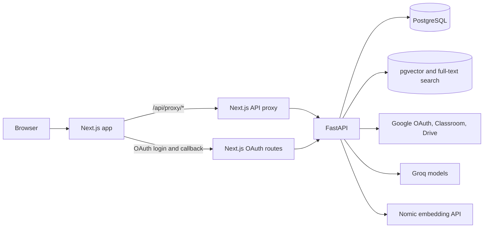
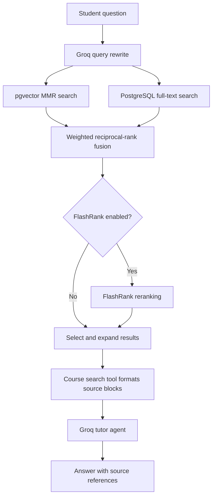

# OptiLearn

**An AI learning companion for your course materials.**

OptiLearn brings Google Classroom course files and personal study documents into one workspace. Index supported materials, ask questions in a conversational tutor, and explore answers with retrieval from your course content.

**Built and developed by Nikky** · [GitHub profile](https://github.com/Nikky-SDE) · [Repository](https://github.com/Nikky-SDE/OptiLearn)

> OptiLearn is an actively developed project. Google, Groq, Nomic, PostgreSQL, Vercel, and Render integrations require their own credentials and configuration. The repository does not include verified live deployment URLs or performance benchmarks.

## Table of contents

- [Features](#features)
- [Screenshots](#screenshots)
- [Technology stack](#technology-stack)
- [Architecture](#architecture)
- [Project structure](#project-structure)
- [AI tutor and retrieval](#ai-tutor-and-retrieval)
- [How OptiLearn works](#how-optilearn-works)
- [Installation and local setup](#installation-and-local-setup)
- [Environment variables](#environment-variables)
- [API documentation](#api-documentation)
- [Deployment](#deployment)
- [Performance and benchmarks](#performance-and-benchmarks)
- [Roadmap](#roadmap)
- [Contributing](#contributing)
- [License](#license)
- [Author](#author)

## Features

- Sync courses from Google Classroom and retrieve supported course files from Google Drive.
- Upload PDF, DOCX, PPTX, TXT, Markdown, and common image files to an existing course.
- Extract document text and image descriptions, then index them for semantic and full-text search.
- Ask a course-aware AI tutor questions in a chat interface, with persisted conversation sessions.
- Stream tutor output over Server-Sent Events (SSE).
- Generate topic summaries and flashcards from retrieved course material.
- Use optional Groq web search when explicitly requested in chat.

Courses are synced from Google Classroom; the current API does not create standalone local courses. Audio and video transcription are not implemented in the inspected codebase.

## Screenshots

The screenshots supplied with this project are not currently stored in the repository. Save each image to the path shown below, then the Markdown links will render on GitHub.

<!-- Save supplied screenshot 1 (landing page) to docs/screenshots/landing-page.png. -->


<!-- Save supplied screenshot 2 (dashboard) to docs/screenshots/dashboard.png. -->


<!-- Save supplied screenshot 3 (classrooms) to docs/screenshots/classrooms.png. -->


<!-- Save supplied screenshot 4 (AI tutor chat) to docs/screenshots/ai-chat.png. -->


## Technology stack

| Area | Technologies |
|---|---|
| Frontend | Next.js 16, React 19, TypeScript, Tailwind CSS v4, Radix UI |
| Backend | Python 3.11, FastAPI, Uvicorn, SQLAlchemy |
| AI orchestration | LangChain, LangGraph, Groq |
| Retrieval and storage | PostgreSQL, pgvector, PostgreSQL full-text search, Nomic hosted embeddings |
| Google integrations | Google OAuth, Google Classroom API, Google Drive API |
| Deployment configuration | Vercel frontend instructions, Render Docker service configuration |

## Architecture

The Next.js app serves the interface and same-origin API proxy. FastAPI handles authentication, classroom sync, uploads, indexing, retrieval, and tutoring. PostgreSQL stores application data, vector embeddings, and tutor checkpoints. Google APIs provide OAuth and course-file access; Groq and Nomic provide model and embedding APIs.



### Project structure

```text
app/
  api/routes/       FastAPI auth, chat, classroom, file, and indexing endpoints
  core/             Settings, database access, security, errors, and utilities
  models/           SQLAlchemy User, Course, and File models
  processing/       PDF, image, office/text extraction, and chunk enrichment
  rag/              Tutor agent, prompts, tools, retriever, vector store, memory
  services/         Google OAuth, Classroom, and Drive integrations
  workflows/        LangGraph document-indexing state, nodes, and graph
frontend/
  app/              Next.js pages, layouts, OAuth routes, and API proxy
  components/       Navigation, theme, and reusable UI components
  hooks/            UI hooks
  lib/              API client, auth context, and shared utilities
  public/           Icons and OptiLearn wordmark
tests/              Python unittest suite
.github/workflows/  GitHub Actions CI workflow
Dockerfile          Backend container
render.yaml         Render service blueprint
requirements.txt    Python dependencies
```

## AI tutor and retrieval

The tutor is built with LangChain's agent API, backed by LangGraph. Its tools can search indexed course material, summarize a topic, create flashcards, or perform Groq web search when the student explicitly asks. Tutor conversations use a PostgreSQL checkpoint saver keyed by session ID.

Document indexing is a separate explicit LangGraph workflow: download, process, chunk, embed, then update the file record. It currently uses an in-memory checkpoint for each invocation, so it does not provide durable indexing recovery across a process restart.

The retrieval path combines PostgreSQL vector search and full-text search:



Implementation details:

- **Embeddings:** `nomic-embed-text-v1.5` through Nomic's remote API, configured for 768 dimensions. The setting named `EMBEDDING_MODEL` is not used by the active embedding adapter.
- **Chunking:** `RecursiveCharacterTextSplitter`, default 800-character chunks with 200-character overlap. Each chunk receives file/course metadata, a source prefix, parent text (up to 1,600 characters), and neighboring chunk text.
- **Vector search:** user-specific pgvector collections and MMR retrieval, optionally filtered by course. The application attempts to configure a cosine HNSW index.
- **Keyword search:** PostgreSQL English full-text search using `websearch_to_tsquery`, with a `plainto_tsquery` fallback.
- **Fusion and reranking:** reciprocal-rank fusion weights vector results at 0.7 and full-text results at 0.3. FlashRank can rerank results but is disabled by default.
- **Grounding:** course search formats retrieved chunks with numbered source labels. The tutor prompt asks the model to use these sources and say when material is not found; this does not guarantee every answer is fully grounded.
- **Streaming:** the chat stream endpoint emits SSE events for answer chunks and tool activity. The current backend stream does not emit the citations event supported by the frontend parser, so streamed citations may be unavailable.

## How OptiLearn works

1. Sign in with Google and sync courses from Google Classroom.
2. Sync supported files from Drive or upload a supported document/image to one of your courses. Uploads are capped at 100 MiB and saved under the configured local upload directory.
3. Start indexing. The backend extracts text or image descriptions, creates chunks and metadata, requests embeddings from Nomic, and stores them in the user's pgvector collection.
4. Ask a question in the tutor. The query is rewritten, searched through vector and full-text retrieval, fused, optionally reranked, and sent to the Groq-backed agent with retrieved source blocks.
5. Continue the conversation using the session checkpoint stored in PostgreSQL. Use the non-streamed endpoint for a response with citation metadata, or the SSE endpoint for progressive output.

## Installation and local setup

### Prerequisites

- Python 3.11
- Node.js 22 (the version used by the repository CI workflow)
- PostgreSQL with the pgvector extension available
- Google OAuth credentials for Google sign-in and Classroom/Drive features
- A Groq API key and a Nomic API key for AI and embedding features

### Backend

From the repository root, create a virtual environment, install the declared dependencies, and configure `.env`:

```powershell
py -3.11 -m venv .venv
.\.venv\Scripts\Activate.ps1
python -m pip install -r requirements.txt
Copy-Item .env.example .env
```

Edit `.env` with your PostgreSQL/pgvector connection, stable secrets, and integration settings. Then start the API:

```powershell
uvicorn app.main:app --reload
```

The API health route is at `http://localhost:8000/health`; Swagger UI is at `http://localhost:8000/docs`.

### Frontend

In a second terminal:

```powershell
Set-Location frontend
npm ci
Copy-Item .env.example .env.local
npm run dev
```

Set `NEXT_PUBLIC_BACKEND_URL` and `BACKEND_URL` to `http://localhost:8000` for local development. Open `http://localhost:3000`.

### Tests and frontend checks

The backend CI command is:

```powershell
python -m unittest discover -s tests -v
```

Frontend scripts defined by `package.json`:

```powershell
npm run lint
npm run typecheck
npm run build
```

The frontend package does not currently define a test script.

## Environment variables

Use `.env.example` and `frontend/.env.example` as templates. Replace placeholders locally and set deployment values in the hosting provider. Do not commit real credentials. The backend reads `.env` through Pydantic Settings; values can also be supplied in the process environment.

| Variable | Purpose | Code default / requirement |
|---|---|---|
| `DATABASE_URL` | PostgreSQL connection for async SQLAlchemy and derived sync connections | Local URL in settings; production database value required |
| `JWT_SECRET` | Signs application access and refresh tokens | Random value at startup if unset; set a stable secret |
| `SECRET_KEY` | Signs the OAuth/session cookie | Random value at startup if unset; set a stable secret |
| `FERNET_KEY` | Encrypts stored Google OAuth tokens | Generated at startup if unset; set a stable key so stored tokens remain decryptable |
| `GOOGLE_CLIENT_ID` | Google OAuth client ID | Optional in settings; required for Google sign-in |
| `GOOGLE_CLIENT_SECRET` | Google OAuth client secret | Optional in settings; required for Google sign-in |
| `GOOGLE_REDIRECT_URI` | Google OAuth callback URI | Defaults to local frontend callback; set to `https://<frontend-domain>/api/auth/callback` in deployment |
| `FRONTEND_URL` | Frontend origin used when constructing/validating redirects | No default; configure for deployment as needed |
| `BACKEND_CORS_ORIGINS` | Allowed browser origins and redirect allowlist | Defaults to localhost origins; include the deployed frontend origin |
| `GROQ_API_KEY` | Server-side fallback key for chat/model features | Optional; chat can also receive a user-provided key in `X-Groq-Api-Key` |
| `NOMIC_API_KEY` | Hosted embedding API authentication | No default; required for vector indexing and retrieval |
| `UPLOAD_DIR` | Local storage path for uploaded/downloaded files | `./uploads` |
| `NEXT_PUBLIC_BACKEND_URL` | Backend origin used by frontend routes and CSP | Frontend fallback is `http://localhost:8000` |
| `BACKEND_URL` | Server-side backend origin for Next.js proxy and OAuth routes | Falls back to `NEXT_PUBLIC_BACKEND_URL`, then localhost |
| `BFF_BACKEND_SESSION_COOKIE_NAME` | Backend session cookie name used by OAuth handoff | `session` |
| `VECTOR_EMBEDDING_DIM` | Embedding and pgvector dimensions | `768` |
| `RAG_CHUNK_SIZE` / `RAG_CHUNK_OVERLAP` | Character-based text chunking | `800` / `200` |
| `RAG_ENABLE_RERANK` | Enable FlashRank reranking | `false` |
| `PDF_EXTRACT_IMAGES` | Enable image extraction/vision parsing inside PDFs | `false` |

Additional cookie/CSRF controls, model names, pool/index settings, and retrieval options are defined in [app/core/config.py](app/core/config.py). `EMBEDDING_MODEL`, `SUPABASE_URL`, and `SUPABASE_KEY` are declared there but are not used by the current implementation.

**Deployment note:** the backend generates random fallbacks for JWT, session, and Fernet secrets. Set stable values in deployment or sessions and encrypted Google tokens will not survive restarts/key changes. Uploaded files use local disk; the included Render configuration does not define persistent storage.

## API documentation

When the backend is running, use [Swagger UI](http://localhost:8000/docs). API routes are mounted at the root prefixes below (for example `/chat/query`); `/api/v1` is used for the OpenAPI JSON URL and is not a prefix on these routes.

| Endpoint | Method | Purpose | Authentication |
|---|---|---|---|
| `/` | GET | Backend welcome response | Public |
| `/health` | GET | Health response | Public |
| `/auth/login` | GET | Begin Google OAuth | Public |
| `/auth/callback` | GET | Complete OAuth and issue cookies | OAuth state/session |
| `/auth/refresh` | POST | Refresh JWT cookies | Refresh cookie + CSRF |
| `/auth/logout` | POST | Clear session cookies | CSRF |
| `/auth/me` | GET | Current user profile | Access cookie |
| `/classroom/courses` | GET | List synced courses | Access cookie |
| `/classroom/courses/sync` | GET | Sync courses from Google Classroom | Access cookie |
| `/classroom/courses/{course_id}/sync-files` | POST | Start Drive file sync | Access cookie |
| `/classroom/courses/{course_id}/files` | GET | List course files | Access cookie |
| `/files/upload` | POST | Upload supported file as multipart form data | Access cookie |
| `/files/supported-formats` | GET | List accepted extensions | Access cookie |
| `/indexing/file/{file_id}` | POST / DELETE | Start indexing / remove file vectors | Access cookie |
| `/indexing/course/{course_id}` | POST / DELETE | Index pending files / remove course vectors | Access cookie |
| `/indexing/status/{file_id}` | GET | Read indexing status | Access cookie |
| `/chat/query` | POST | Get a complete answer and citation metadata | Access cookie |
| `/chat/query/stream` | POST | Stream answer and tool events as SSE | Access cookie |
| `/chat/sessions` | GET | List chat sessions | Access cookie |
| `/chat/history/{session_id}` | GET | Read session messages | Access cookie |
| `/chat/session/{session_id}` | DELETE | Clear a chat session | Access cookie + CSRF |

Authentication uses HttpOnly cookies rather than the bearer-header flow described in an old chat endpoint docstring. Mutating requests require the configured CSRF header.

## Deployment

The repository includes a Render Docker service definition and backend Dockerfile. The frontend README documents using `frontend/` as the Vercel project root. These files describe intended deployment; no live deployment was verified as part of the repository audit.

### Render backend

1. Create a Render web service from this repository and use the repository root as the Docker context.
2. The included `render.yaml` selects `Dockerfile` and `/health` as the health check.
3. Configure a PostgreSQL database with pgvector, stable backend secrets, Google OAuth values, `GROQ_API_KEY`, `NOMIC_API_KEY`, `FRONTEND_URL`, and `BACKEND_CORS_ORIGINS` in the Render environment.
4. Keep in mind that the configured upload directory is local disk; the Render blueprint does not configure persistent storage.

### Vercel frontend

1. Create a Next.js project with `frontend/` as its root directory.
2. Set `NEXT_PUBLIC_BACKEND_URL` and `BACKEND_URL` to the Render backend origin.
3. Set the backend `GOOGLE_REDIRECT_URI` to `https://<your-frontend-domain>/api/auth/callback`.
4. Add the frontend origin to the backend `BACKEND_CORS_ORIGINS` JSON list.

There is no `vercel.json`; Vercel project settings and environment values must be configured in Vercel. Add your final frontend and backend URLs here after verifying them.

## Performance and benchmarks

No benchmark, Lighthouse, API latency, ingestion throughput, retrieval latency, or load-test results are available in the repository audit. No performance figures are claimed here. For meaningful measurements, use a fixed course-document dataset and record query latency, time to first streamed token, total response time, ingestion duration, error rate, and database resource use.

## Roadmap

These are proposals, not implemented features:

- Add durable background workers and recovery for interrupted indexing/classroom sync.
- Add automated integration and end-to-end tests for upload, indexing, retrieval, and streamed citations.
- Add shared rate limits and operational metrics for authentication, uploads, and inference.
- Evaluate retrieval quality and the optional reranker with a labeled question set.
- Add audio/video transcription and frame extraction if multimodal media support is a product goal.
- Move uploaded files to persistent object storage for deployments where local disk is ephemeral.

## Contributing

1. Fork the repository and create a focused branch.
2. Set up PostgreSQL with pgvector and configure local environment files using the examples.
3. Install backend and frontend dependencies using the setup steps above.
4. Run the Python unittest suite and frontend lint, typecheck, and build commands before opening a pull request.
5. Describe the change, configuration impact, and verification performed.

GitHub Actions runs frontend lint/typecheck/build and backend unittest discovery for pushes and pull requests targeting `main`.

## License

This project is licensed under the MIT License. See [LICENSE](LICENSE).

## Author

**Nikky** · [GitHub profile](https://github.com/Nikky-SDE) · [OptiLearn repository](https://github.com/Nikky-SDE/OptiLearn)
